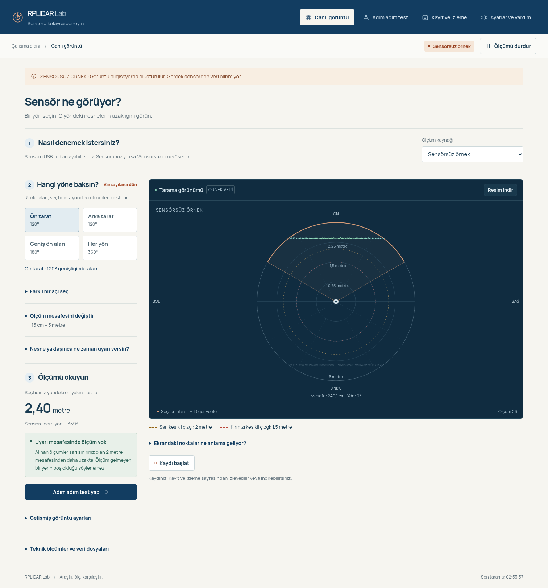
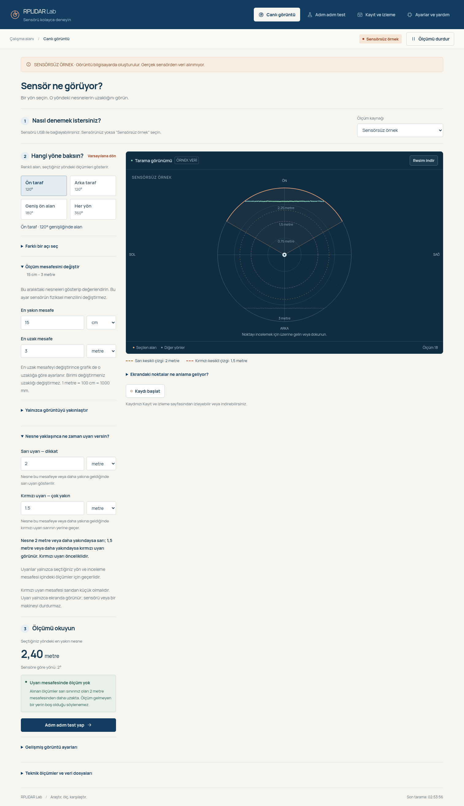
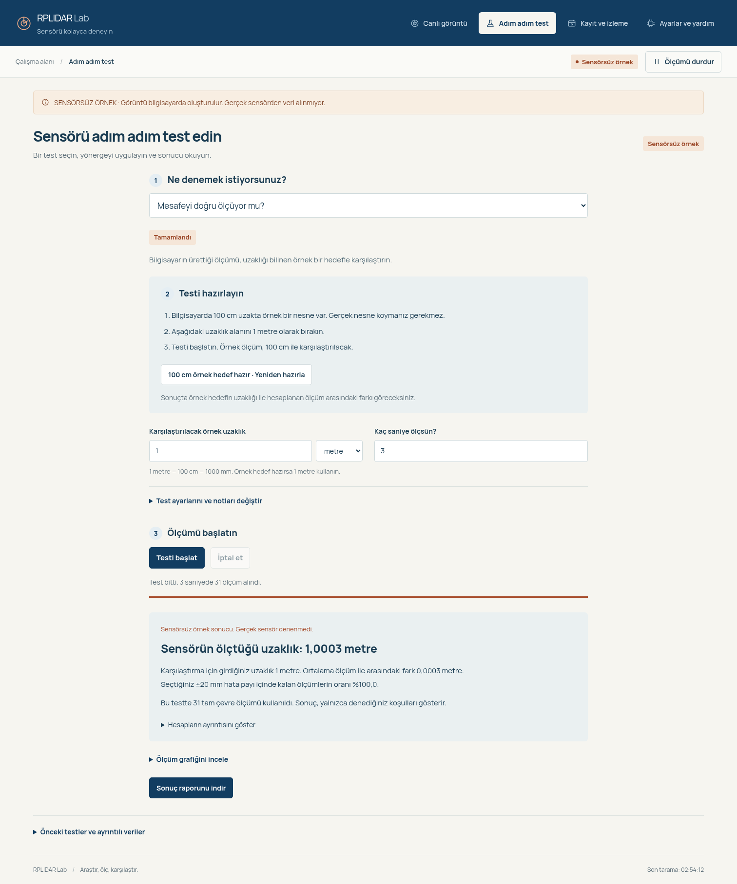
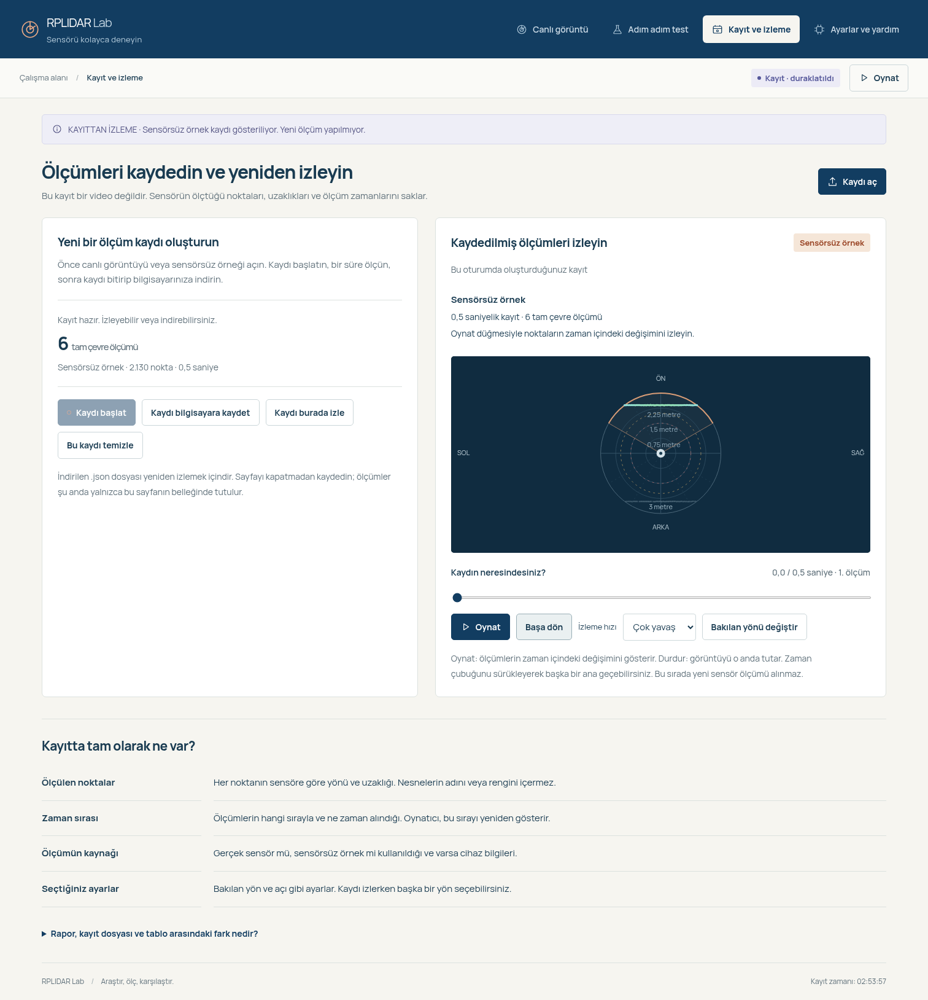

# RPLIDAR Lab

**LiDAR sensörünü görün, deneyin, ölçümleri karşılaştırın ve kaydedin.**

RPLIDAR Lab, SLAMTEC RPLIDAR sensörlerinin çevresindeki nesnelere olan uzaklığını bilgisayarda gösteren, Türkçe arayüzlü bir ölçüm ve deney uygulamasıdır. Hangi yöne bakılacağını, hangi mesafelerin inceleneceğini ve nesne yaklaştığında ne zaman uyarı gösterileceğini seçebilirsiniz. Adım adım testler, sensörün belirli koşullarda nasıl ölçüm yaptığını incelemenize yardımcı olur.

Öğrenciler, öğretim üyeleri ve sensörle ilk kez çalışacak kullanıcılar için hazırlanmıştır. Bilgisayarınızda çalışır; normal kullanım için internet, bulut hesabı veya tarayıcı eklentisi gerekmez. **Sensörünüz yokken de örnek verilerle programı deneyebilirsiniz.**



_Görseller uygulamanın gerçek arayüzünden, sensörsüz örnek modunda alınmıştır. Görünen sonuçlar fiziksel bir sensörün performansını göstermez; ekranlardaki ayarlar değiştirilebilir örneklerdir._

[Başlangıç kılavuzu](docs/QUICKSTART_TR.md) · [USB bağlantısı](docs/USB.md) · [Deney yöntemleri](docs/EXPERIMENTS.md) · [Araştırma kaynakları](docs/RESEARCH.md) · [Doğrulama durumu](docs/VALIDATION.md)

## Program ne işe yarar?

LiDAR, lazerle nesnelere olan uzaklığı ölçer. Ekranın ortasındaki işaret sensörü, etrafındaki noktalar ise ölçülen yön ve uzaklıkları temsil eder. Merkeze yakın noktalar, daha yakın nesneleri gösterir.

| Yapmak istediğiniz                                  | Uygulamada karşılığı                                                              |
| --------------------------------------------------- | --------------------------------------------------------------------------------- |
| Sensörün önünde veya arkasında ne olduğunu görmek   | Ön 120°, arka 120°, geniş ön alan 180°, her yön 360° veya özel açı seçimi         |
| Belirli uzaklıktaki nesneleri incelemek             | En yakın / en uzak mesafe ve mm, cm, metre seçimi                                 |
| Nesne yaklaştığında uyarı görmek                    | Ayrı sarı ve kırmızı mesafe sınırları, açıklamalı ekran uyarıları                 |
| Ölçümü bilinen bir uzaklıkla karşılaştırmak         | Referans uzaklık, hata payı ve süreyle mesafe doğruluğu testi                     |
| Tekrarlanan ölçümleri ve farklı yüzeyleri incelemek | Tekrarlanabilirlik ve yüzey karşılaştırma testleri                                |
| Bir denemeyi sonradan yeniden izlemek               | Ölçüm kaydı, oynatma, yavaşlatma ve zaman çubuğu                                  |
| Sonuçları paylaşmak veya başka bir araçta incelemek | Okunabilir rapor, CSV tablosu, JSON verileri ve grafik resmi                      |
| Bağlı cihazı tanımak                                | Cihazın bildirdiği model, seri numarası, yazılım sürümü, sağlık ve tarama modları |

## Hızlı başlangıç

### Sensör olmadan deneyin

Proje klasöründe terminal açın:

```bash
./start.sh --demo
```

Tarayıcıda `http://localhost:8080` açılır. **Sensörsüz örnek** modunda oda, 1 metre uzaktaki hedef, hareketli nesne ve eksik ölçüm senaryolarını deneyebilirsiniz. Bu modda gerçek sensörden veri alınmaz.

Demo için Python 3.10 veya üzeri yeterlidir; derleyici gerekmez.

### USB sensörle çalıştırın

Mevcut başlatma akışı Linux içindir. Python 3.10+, C++17 destekli `g++` ve GNU Make gerekir:

```bash
./start.sh
```

Başlatıcı gerektiğinde sensör bağlantı programını derler, yerel hizmeti başlatır ve arayüzü açar. Desteklenen USB seri bağlantıları arka planda aranır; bağlantı hızları otomatik denenir. Bağlantı kesilirse yeniden bağlanma denenir. İşletim sisteminin seri porta ilk erişim izni gerekebilir; adımlar [USB bağlantı kılavuzunda](docs/USB.md) açıklanmıştır.

Tarayıcı otomatik açılmazsa `http://localhost:8080` adresine gidin. Uygulamayı kapatmak için terminalde **Ctrl+C** kullanın.

## İlk kullanımda ne yapacağım?

1. **Canlı görüntü** sayfasında USB sensörünü veya **Sensörsüz örnek** seçeneğini seçin.
2. **Hangi yöne baksın?** bölümünden ön, arka veya her yönü seçin.
3. **Ölçüm mesafesini değiştir** bölümünden incelemek istediğiniz en yakın ve en uzak mesafeyi girin.
4. **Ölçümü okuyun** bölümünden seçtiğiniz yöndeki en yakın nesnenin uzaklığına bakın.
5. Bir karşılaştırma yapmak için **Adım adım test**, ölçümleri saklamak için **Kayıt ve izleme** sayfasına geçin.

Teknik ayarlar ve ayrıntılı veriler, açıklamalı açılır bölümlerde bulunur. İlk deneme için bu bölümleri kullanmanız gerekmez.

## Mesafe, birim ve uyarı ayarları

**Canlı görüntü → Ölçüm mesafesini değiştir** bölümünde her sayının yanından **mm**, **cm** veya **metre** seçebilirsiniz. Birimi değiştirdiğinizde uzaklık korunur: **1 metre = 100 cm = 1000 mm**.

Örneğin en yakın mesafeyi **15 cm**, en uzak mesafeyi **3 metre** yaparsanız bu aralıktaki ölçümler gösterilip değerlendirilir. En uzak mesafeyi değiştirdiğinizde grafik de buna göre ayarlanır. **Yalnızca görüntüyü yakınlaştır** seçeneği ise sadece grafiğin ölçeğini değiştirir.

**Nesne yaklaşınca ne zaman uyarı versin?** bölümünde iki sınır belirleyebilirsiniz:

- **Sarı: 1 metre** → Nesne 1 metreye veya daha yakına geldiğinde dikkat uyarısı.
- **Kırmızı: 50 cm** → Nesne 50 cm'ye veya daha yakına geldiğinde kırmızı uyarı. Kırmızı uyarı sarının yerine geçer.

Kırmızı sınır sarıdan küçük olmalıdır. Grafiğin altındaki açıklamalar kesikli çizgilerin mesafelerini, uyarı metni ise nesnenin uzaklığını ve uyarının nedenini gösterir. Uyarılar seçtiğiniz yön ve inceleme aralığı içindeki ölçümlere göre oluşur.



_Bu ekran görüntüsünde sarı 2 metre, kırmızı 1,5 metre seçilmiştir. Yukarıdaki 1 metre / 50 cm örneği dahil, sınırları kendiniz değiştirebilirsiniz._

Açı ve mesafe seçimleri, alınan ölçümleri yazılımda süzer; sensörün fiziksel menzilini veya lazerin taradığı alanı değiştirmez. Uyarılar ekranda gösterilir; bir makineyi durdurmaz.

## Adım adım sensör testleri

**Adım adım test** sayfası önce neyi araştırmak istediğinizi sorar, ardından hazırlığı anlatır. Uzaklık ve hata payı alanlarında mm, cm veya metre kullanabilirsiniz.

| Test sorusu                         | Ne incelenir?                                                                                          |
| ----------------------------------- | ------------------------------------------------------------------------------------------------------ |
| Mesafeyi doğru ölçüyor mu?          | Ölçüm ortalamasının girdiğiniz referans uzaklıktan farkı ve seçtiğiniz hata payı içinde kalan ölçümler |
| Aynı nesneyi hep benzer ölçüyor mu? | Sabit hedefin tekrarlanan ölçümlerindeki değişim                                                       |
| Farklı yüzeyleri görebiliyor mu?    | Aynı koşullarda farklı yüzeylerden alınan ölçümlerin devamlılığı ve dağılımı                           |
| Kesintisiz ölçüm yapabiliyor mu?    | Tarama hızı ve alınan ölçümlerin sürekliliği                                                           |
| Ön ve arka alanları görebiliyor mu? | Seçilen açısal alanlarda ölçüm gelen yönler                                                            |
| Yakındaki nesneyi görebiliyor mu?   | Seçilen hedef yönünde ölçüm alınıp alınmadığı                                                          |

Sensörsüz bir mesafe denemesi için **100 cm örnek hedefi hazırla** düğmesini kullanın, karşılaştırma uzaklığını **100 cm** veya **1 metre** bırakın ve **Testi başlat** düğmesine basın. Sonucu sayfanın altındaki açıklamadan okuyabilirsiniz. **Sonuç raporunu indir** ile raporu kaydedebilir; tarayıcının yazdırma menüsünden PDF oluşturabilirsiniz.



_Örnek veriden üretilen test sonucu. Gerçek sensörün doğruluğunu değerlendirmek için ayrı fiziksel ölçümler ve bilinen bir referans gerekir. Deney koşulları ve hesap yöntemleri [deney dokümanında](docs/EXPERIMENTS.md) açıklanmıştır._

## Kayıt ve yeniden izleme

Kayıt; ölçülen noktaların yönünü, uzaklığını, zaman sırasını, ölçüm kaynağını ve seçilen ayarları saklar. Nesnelerin fotoğrafını veya rengini içermez.

1. Canlı görüntüde **Kaydı başlat**, birkaç saniye sonra **Kaydı bitir** düğmesine basın.
2. **Kayıt ve izleme** sayfasında **Kaydı burada izle** seçeneğini kullanın. İzlemek için önce dosya indirmeniz gerekmez.
3. **Oynat**, **Durdur**, **Başa dön**, hız seçimi ve zaman çubuğuyla ölçümlerin zaman içindeki değişimini inceleyin.
4. Başka zaman izlemek için **Kaydı bilgisayara kaydet** ile dosyayı indirin. Daha sonra **Kaydı aç** ile yeniden yükleyin.

İndirilmemiş ölçümler sayfanın belleğinde tutulur; sayfa kapatılırsa kaybolur. Yeniden izlerken yeni sensör ölçümü yapılmaz.



_Sensörsüz örnekten alınmış kısa bir kaydın durdurulmuş görünümü. Noktalar, kayıt sırasında alınan ölçümlerdir._

### İndirilen dosyalarda ne var?

| Dosya                 | İçeriği                                     | Nasıl kullanılır?                            |
| --------------------- | ------------------------------------------- | -------------------------------------------- |
| Sonuç raporu `.html`  | Testlerin okunabilir özeti                  | Tarayıcıda açın, paylaşın veya PDF yazdırın. |
| Kayıt `.json`         | Zaman sıralı ölçümler ve ayarlar            | **Kaydı aç** ile yeniden izleyin.            |
| Ölçüm tablosu `.csv`  | Tek bir anda, seçilen yöndeki noktalar      | Excel veya benzeri bir araçla inceleyin.     |
| Tek ölçüm `.json`     | Bir ölçümün sayısal noktaları ve ayarları   | Yazılımla ayrıntılı inceleme yapın.          |
| Test verileri `.json` | Test koşulları, hesaplar ve ölçüm kanıtları | Deneyi teknik olarak inceleyin.              |
| Grafik `.png`         | Ekrandaki ölçüm grafiği                     | Sunuma veya rapora ekleyin.                  |

JSON, verilerin düzenli biçimde saklandığı bir dosya biçimidir. Her JSON dosyası oynatılabilir kayıt değildir; tek ölçüm ve test dosyaları kayıt oynatıcısında açılmaz. Sayısal JSON/CSV uzaklıkları tutarlılık için **mm** cinsindedir; okunabilir test sonuçları referans ve hata payı için seçtiğiniz birimleri korur.

## Cihaz desteği ve doğrulama

Uygulama, depoya dahil edilen SLAMTEC SDK üzerinden seri bağlantılı RPLIDAR cihazlarıyla iletişim kurar. Cihazın bildirdiği model, tarama modları ve desteklenen kontroller gösterilir. Kullanılabilen özellikler modele, donanım sürümüne ve tarama moduna bağlıdır; bütün RPLIDAR modelleriyle fiziksel uyumluluk doğrulanmış değildir.

Bu sürümün 22 Python/JavaScript kontrolü, DOM akışları ve gerçek tarayıcıdaki masaüstü/telefon senaryoları geçmiştir. Görseller bu tarayıcı akışlarından alınmıştır. Son geliştirmeler sırasında fiziksel sensör kullanılamadığı için USB takıp çıkarma, gerçek ölçüm doğruluğu ve cihaz performansı ayrıca doğrulanmalıdır. Ayrıntılar: [doğrulama kaydı](docs/VALIDATION.md).

Ölçüm gelmeyen bir yönün boş olduğu söylenemez. Nokta birleştirme görünümü tek başına konum kestirimi veya SLAM haritalama yapmaz. Bu yazılım testleri, fiziksel güvenlik veya koruyucu sistem uygunluğu kanıtı değildir.

## Geliştiriciler için

### Dosya yapısı

```text
server.py              Yerel HTTP/SSE hizmeti, USB keşfi ve bağlantı yönetimi
lidar_bridge.cpp       SLAMTEC SDK ile sensör iletişimi
web/core.js            Geometri, birim dönüşümü, istatistik ve veri doğrulama
web/app.js             Görselleştirme, deneyler, kayıt ve yeniden izleme
web/styles.css         Masaüstü ve telefon arayüzü
rplidar_sdk/            Sabitlenmiş üretici SDK'sı ve özgün lisansı
assets/                Yerel yazı tipi ve SVG dosyaları
tests/                 Birim, DOM ve tarayıcı kontrolleri
docs/                  Kullanım, deney yöntemleri ve doğrulama kayıtları
docs/images/           README'de kullanılan gerçek arayüz görüntüleri
scripts/               Kaynak paketleme ve Git yardımcıları
.github/workflows/     Derleme, test ve tarayıcı kanıtı iş akışı
```

### Çalıştırma seçenekleri

```bash
# Tarayıcıyı otomatik açmadan örnek veriyle çalıştırma
python3 server.py --demo

# Farklı bir yerel port kullanma
./start.sh --demo --port 8081

# Bilinen USB portunu doğrudan seçme
LIDAR_PORT=/dev/ttyUSB0 ./start.sh
```

### Kontroller

```bash
make                     # Yerel sensör bağlantı programını derle
make test                # Python ve JavaScript birim kontrolleri
npm install              # DOM testi için geliştirme bağımlılıkları
npm run test:dom
python3 -m pip install playwright==1.61.0
python3 -m playwright install chromium
python3 tests/browser_smoke.py
```

JavaScript kontrolleri için Node.js gerekir. Geliştirme bağımlılıklarını indirmek için internet gerekir; uygulamanın normal çalışması bu bağımlılıklara ihtiyaç duymaz. [Mimari](docs/ARCHITECTURE.md) ve [araştırma kaynakları](docs/RESEARCH.md) teknik ayrıntıları açıklar.

### Kaynak paketi ve açık kaynak paylaşımı

Proje standart bir yerel Git deposudur. Kaynak paketini güncellemek için:

```bash
python3 scripts/package.py
```

Paket `dist/rplidar-lab-1.0.0.tar.gz` konumuna yazılır; yanında SHA-256 doğrulama dosyası bulunur. Paket, Git'in izlediği kaynakları ve README görsellerini içerir; yerel Git geçmişini, test çıktıları klasörünü ve derlenmiş programları içermez. Yeni dosyaların pakete girmesi için önce Git'e eklenmesi gerekir. Uzak depoya yayınlama ayrıca yapılır.

## Lisans

Uygulama kodu [MIT lisanslıdır](LICENSE). SLAMTEC SDK BSD-2-Clause, Manrope yazı tipi SIL OFL 1.1 lisanslıdır. Ayrıntılar [üçüncü taraf bildirimlerindedir](THIRD_PARTY_NOTICES.md). RPLIDAR Lab bağımsız bir projedir; resmî bir SLAMTEC ürünü değildir.
